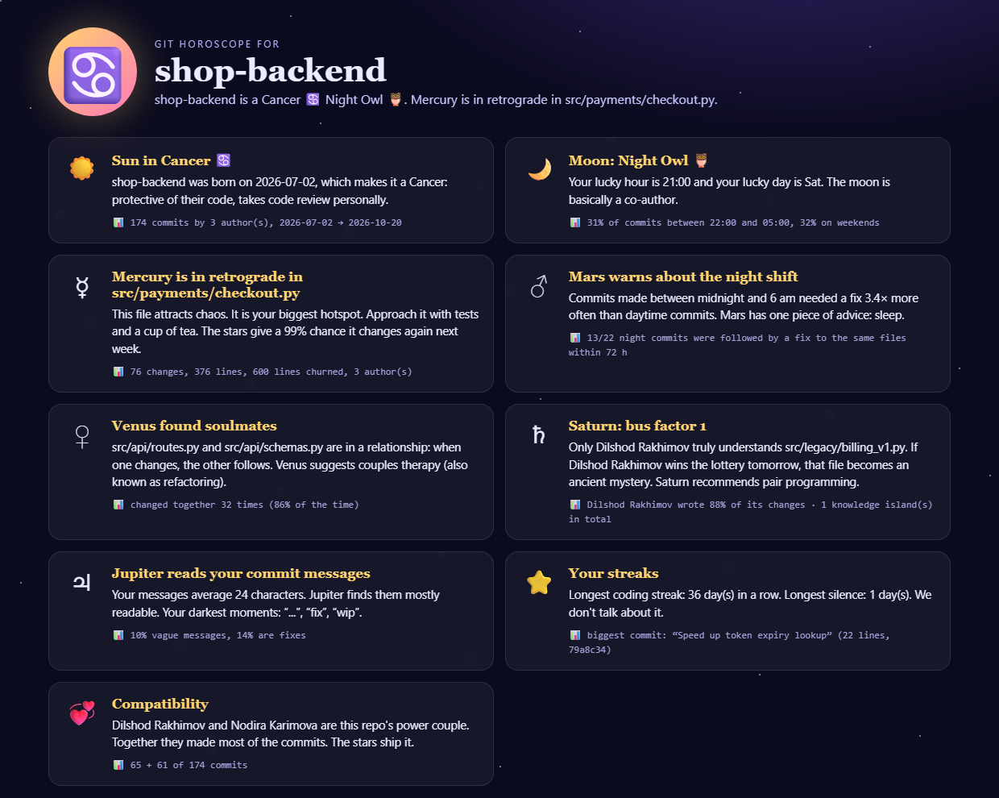
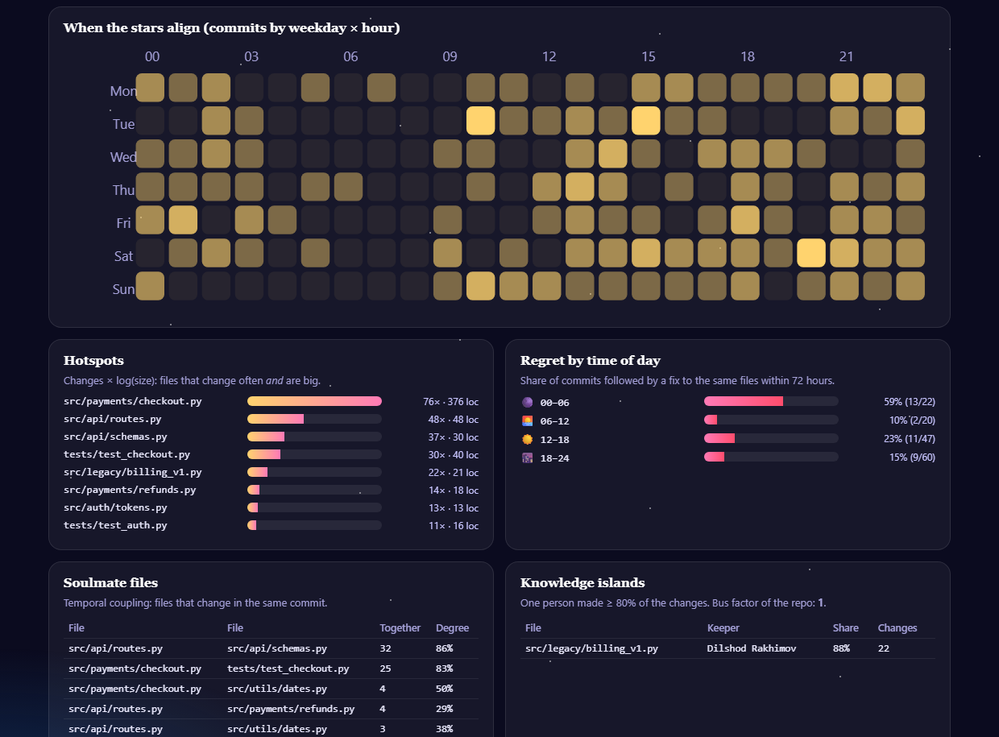

# 🔮 git-horoscope

**Real repository analytics, delivered as a horoscope.**

Point it at any git repository. It reads the whole history and finds the things senior
engineers worry about:

- **hotspots**: files that change constantly *and* are big
- **knowledge islands**: files only one person understands, and the repo's *bus factor*
- **temporal coupling**: files that secretly always change together
- **regret by time of day**: how often a commit needed a fix soon afterwards

Then it explains all of it in the voice of an astrologer. Every reading quotes the exact
number it's based on.

[](https://github.com/GGmanforeal/git-horoscope/actions/workflows/ci.yml)




## Why a horoscope?

Code-health reports are useful, but nobody reads them. A horoscope gets read and shared.
So the jokes are the delivery and the numbers are real:

| The horoscope says | What was actually measured |
|---|---|
| ☀️ *"shop-backend is a Cancer: takes code review personally."* | Date of the first commit (this one is just for fun) |
| 🌙 *"Moon: Night Owl 🦉. Lucky hour 21:00."* | Commit time distribution: 31% between 22:00 and 05:00 (author's local time) |
| ☿ *"Mercury is in retrograde in src/payments/checkout.py… 99% chance it changes again next week."* | Hotspot score = revisions × log₂(lines of code). Next-week probability from a Poisson model of its change rate |
| ♂ *"Commits made between midnight and 6 am needed a fix 3.4× more often. Mars advises: sleep."* | For each commit: did a fix/revert/hotfix touch the same files within 72 h? Rates compared by time of day |
| ♀ *"routes.py and schemas.py are in a relationship. Venus suggests couples therapy (refactoring)."* | Temporal coupling: changed in the same commit 32 times (86% of the time) |
| ♄ *"Bus factor 1. Only Dilshod understands billing_v1.py."* | One author made ≥ 80% of a file's changes; bus factor = fewest people who are main author of more than half the files |
| ♃ *"Your darkest moments: '…', 'fix', 'wip'."* | Commit-message quality: average length, share of vague messages, share of fixes |
| ⭐ *"Longest streak: 36 days. Longest silence: we don't talk about it."* | Consecutive commit days and the longest gap |



The analysis ideas come from software-analytics research, especially Adam Tornhill's
*Your Code as a Crime Scene*: hotspots, temporal coupling and knowledge maps. The
"night-commit regret" metric is my own simple version of the fix-inducing-change analysis
used in defect-prediction research.

## Try it

You need [Python 3.10+](https://www.python.org/downloads/) and git. There is nothing else to install.

```bash
git clone https://github.com/GGmanforeal/git-horoscope.git
cd git-horoscope

python -m githoroscope --demo                 # a generated repo with planted patterns
python -m githoroscope C:\path\to\your\repo   # your own project
```

On Windows you can also double-click **`run-demo.bat`**.

Options:

```
--html FILE         where to write the HTML chart (default: horoscope.html)
--no-open           don't open the browser
--since "6 months ago"
--author "Name"
--json              raw analysis as JSON (for scripts / dashboards)
```

### The demo repository

`--demo` builds a realistic fake project in under a second with a single `git fast-import`
stream: about 170 commits over 3 months by 3 people. Patterns are **planted** in it on purpose:

- a hotspot
- two coupled files
- a file only one person touches
- night commits that get fixed more often

The tests check that the analysis finds every planted pattern, so the demo doubles as an
end-to-end test.

## How it works

1. **One `git log` call** (`--numstat -M --no-merges`) with ASCII record and unit separators,
   so any commit message parses safely. Renames like `src/{old => new}/a.py` are normalised,
   and binary files count as zero lines.
2. **Lines of code at HEAD** come from `git ls-files`, skipping binaries and huge files.
3. **The analysis** (`analysis.py`) is pure functions over `Commit` objects, which makes
   each metric easy to unit-test on hand-made histories.
4. **The horoscope** (`horoscope.py`) turns each metric into a reading and keeps the evidence.
5. **The report** (`report.py`) is one self-contained HTML file with inline SVG. It has no
   JavaScript and no external assets, and every name is HTML-escaped.

About 800 lines of Python, **standard library only**.

## Tests

```bash
python -m unittest discover -s tests -t . -v
```

The 23 tests cover:

- log parsing (renames, binary files, author-local time zones)
- every metric on hand-built histories, including the night-regret penalty, the bus factor and coupling degree
- the zodiac boundaries (Capricorn wraps around New Year)
- the Poisson estimate
- HTML escaping of hostile author names
- the CLI, including running on a folder that isn't a repo
- the planted-pattern checks on the demo repo

CI runs on Windows and Linux.

## Ideas for later

- A GitHub Action that posts the weekly horoscope as a comment.
- Per-author horoscopes ("your personal Mercury").
- Using `git blame` for a more precise knowledge map.

## Credits

Made by **Rahimjon Xasanov** ([@GGmanforeal](https://github.com/GGmanforeal)). MIT licensed.
The stars are not responsible for your merge conflicts.
